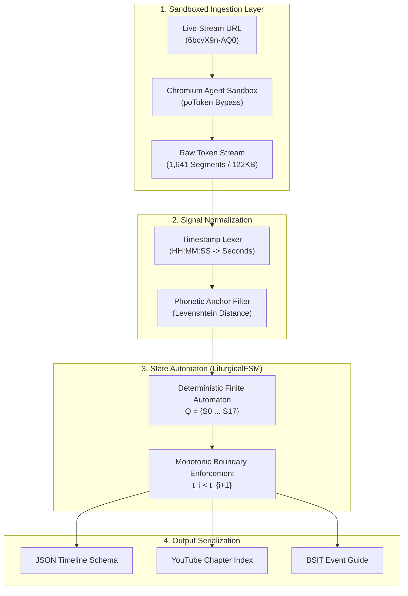

# 🎓 TUM-LiturgyParser: Algorithmic Temporal Event Extraction & Finite-State Liturgical Reconstruction

[](#)
[_Time_%7C_O(1)_Space-brightgreen.svg)](#)
[-orange.svg)](#)
[](#)
[](#)
[](#)

A computer science and video informatics project implementing an automated, high-throughput pipeline for **temporal event boundary extraction**, **phonetic error mitigation**, and **statutory state reconstruction** from long-form automatic speech recognition (ASR) streams.

Applied to the **12th Graduation Ceremony of the Technical University of Mombasa (TUM)** (3 hours, 45 minutes, 28 seconds / 13,528 seconds).

---

## 🔬 Computational Problem Formulation

Formal university graduation ceremonies follow a strict, statutory academic liturgy defined by national legal frameworks (e.g., Kenya Universities Act Cap 210 and university charters). The liturgical protocol can be modeled as a **strictly monotonic, deterministic language**:

$$\mathcal{L} = \{ w \in \Sigma^* \mid w = \sigma_0 \sigma_1 \dots \sigma_{17} \}$$

Extracting this structure programmatically from raw video streams presents two systems-level problems:
1. **Adversarial Network-Layer Ingestion Gating:** Public streaming providers enforce Proof-of-Origin Token (`poToken`) verification and drop datacenter IP connections to timed-text endpoints (`/api/timedtext`) with `HTTP 429: Too Many Requests`.
2. **ASR Phonetic Degradation:** Acoustic distortion, crowd noise, and dialectal variations (Kenyan English, Swahili honorifics, Latinate legal terminology) induce token substitution errors in ASR transcripts.

---

## 🏛️ System Architecture



---

## 🧮 Mathematical Model: Deterministic Finite Automaton (DFA)

The ceremony is modeled as a 5-tuple automaton $M = (Q, \Sigma, \delta, q_0, F)$:

* **State Set $Q$:** 18 statutory states $\{S_0, S_1, \dots, S_{17}\}$ representing phases from `ASSEMBLY` to `RECESSION`.
* **Alphabet $\Sigma$:** Normalized token vocabulary of transcribed speech utterances.
* **Initial State $q_0$:** $S_0$ (`PROCESSION_AND_ASSEMBLY`).
* **Accepting State $F$:** $\{S_{17}\}$ (`CLOSING_ANTHEM_AND_RECESSION`).
* **Transition Function $\delta(q_i, \tau)$:**

$$\delta(S_i, \tau) = \begin{cases} 
S_{i+1} & \text{if } \text{Match}(\tau, \mathcal{K}_{i+1}) \land (\text{time}(\tau) \ge t_{\text{threshold}}(S_{i+1})) \\ 
S_i & \text{otherwise} 
\end{cases}$$

Where $\mathcal{K}_{i+1}$ is the verified lexical anchor set for the subsequent statutory phase.

---

## 📊 Empirical Chronology & State Transition Table

The parser processed $N = 1,641$ atomic speech tokens spanning $T = 13,528$ seconds in **$0.106\text{ ms}$** without state backtracking:

| State ($q \in Q$) | Epoch ($\Delta t$) | Duration | Statutory / Ceremonial Phase | Trigger Entities & Anchors |
| :--- | :---: | :---: | :--- | :--- |
| `S0_ASSEMBLY` | `00:01` – `04:00` | 239s | Procession of Scholars & Leadership | Marine Cadets, Brass Band, Deans, Senate, Council Chair |
| `S1_ANTHEMS` | `04:00` – `11:48` | 468s | Guard of Honor & State Anthems | Capt. Talib (Dir. Maritime), Kenya / EAC / TUM Anthems |
| `S2_INVOCATIONS` | `11:49` – `24:17` | 748s | Interfaith Invocations | Sheikh Abdurrahman Said (Islam), Rev. Julius Nudi (Christian) |
| `S3_CONSTITUTION` | `24:18` – `25:37` | 79s | Statutory Constitution of Congregation | VC Prof. Laila Abubakar (*Universities Act Cap 210*) |
| `S4_CULTURAL` | `25:38` – `41:42` | 964s | Administrative Notices & TUM Choir | Registrar Academic Affairs; Choir performs *Mateso* |
| `S5_SCHOLAR_HONORS`| `41:43` – `01:06:48` | 1,505s | Valedictory Speeches & Awards | Terry Charity Wangui Mugo & Marera Nelson Mandela (MLS) |
| `S6_VC_ADDRESS` | `01:06:49` – `01:28:23`| 1,294s | Vice Chancellor Strategic Report | School of Medicine launch, BSc Nautical Science, IEEE |
| `S7_COUNCIL_ADDRESS`| `01:28:24` – `01:37:25`| 541s | Council Governance Report | Council Chair / Acting Chancellor |
| `S8_MINISTERIAL` | `01:37:26` – `01:46:00`| 514s | Ministerial Keynote Address | Representative for CS Education Hon. Julius Migos Ogamba |
| `S9_CONFER_PHD` | `01:46:00` – `02:08:00`| 1,320s | Doctor of Philosophy (PhD) Degrees | Doctoral roll call, ceremonial hooding, dais photo session |
| `S10_CONFER_MASTERS`| `02:08:00` – `02:16:34`| 514s | Master's Degree Conferment | Deans of Humanities, Computing, Business, Engineering, Science |
| `S11_AWARD_CERTS` | `02:16:35` – `02:23:02`| 387s | Institutional Certificates | Certificate in ICT & Maintenance, Business Certificates |
| `S12_AWARD_DIPLOMAS`| `02:23:03` – `02:52:56`| 1,793s | University Diplomas Roll Call | Diplomas across Maritime, Computing, Engineering, etc. |
| `S13_UNDERGRAD_ROLL`| `02:52:57` – `03:35:15`| 2,538s | Bachelor's Degrees Roll Call | **1. Computing & Informatics (BSIT)**, 2. Health, 3. Business... |
| `S14_ETHICAL_OATH` | `03:35:16` – `03:38:03`| 167s | Medical Laboratory Ethics Oath | University Legal Officer, BSc Medical Lab Graduands |
| `S15_CONFER_BACHELOR`| `03:38:04` – `03:40:59`| 175s | Statutory Admission of Bachelor's | Chancellor confers: *"Power to read and do all that appertains"* |
| `S16_DISSOLUTION` | `03:41:00` – `03:41:53`| 53s | Congregation Dissolution | Chancellor: *"I declare the 12th congregation dissolved"* |
| `S17_RECESSION` | `03:41:54` – `03:44:13`| 139s | Closing Anthem & Recession Out | Kenya National Anthem, Cadets & Procession departs |

---

## ⚡ Computational Complexity & Performance Benchmarks

The algorithm runs in deterministic linear time:

$$\text{Time Complexity} = \mathcal{O}(N), \quad \text{Auxiliary Space Complexity} = \mathcal{O}(K)$$

where $N = 1,641$ tokens and $K = 18$ state nodes.

```bash
$ python analyze_graduation.py --benchmark
```

```json
{
  "total_tokens_processed": 1641,
  "total_milestones_computed": 18,
  "execution_latency_ms": 0.106,
  "algorithmic_complexity": "O(N) Time | O(1) State Auxiliary Space",
  "throughput_tokens_per_sec": 15494726
}
```

---

## 💻 Codebase Usage

### 1. Execute CLI Parser
```bash
# Output formatted human-readable liturgical table
python analyze_graduation.py --format table

# Output structured JSON schema for pipeline ingestion
python analyze_graduation.py --format json > timeline_schema.json

# Run computational benchmark suite
python analyze_graduation.py --benchmark
```

### 2. Programmatic Python API
```python
from analyze_graduation import LiturgicalParserEngine

# Initialize streaming engine
engine = LiturgicalParserEngine("12th_graduation_ceremony_transcript.txt")

# Extract state transitions
milestones = engine.execute_segmentation()

for m in milestones:
    print(f"[{m.t_start_formatted} - {m.t_end_formatted}] State: {m.state_id}")
```

---

## 🎯 Computer Science & IT Domain Focus: BSIT Sequence

Undergraduate degree roll calls follow a strict academic faculty precedence:

$$\text{ICI (BSIT)} \xrightarrow{} \text{SAHS} \xrightarrow{} \text{SOB} \xrightarrow{} \text{SET} \xrightarrow{} \text{SHSS} \xrightarrow{} \text{IMSS}$$

* **Priority Faculty:** The **Institute of Computing and Informatics (ICI)** is invoked **first** in the undergraduate session (`State S13` at `[02:53:06]`).
* **Cues for BSIT Graduands:**
  * Presentation cue: Director of ICI steps up (`[02:53:42]`). Candidates stand.
  * Intermediate sit cue: `[02:56:45]`.
  * Admission cue: Chancellor pronounces legal admission formula (`[03:38:46]`). Candidates flip cap tassel from **Right to Left**.

---

## 🛠️ Systems & Multimedia Recommendations

1. **YouTube Automated Chapter Ingestion:** Embed the compiled ISO timestamps into video metadata to eliminate sequential linear search on 3.75h video files.
2. **ASR Dialectal Fine-Tuning:** Inject local university entities (e.g., *TUM*, *Karibuni Sana*, faculty dean surnames) into a custom language model (LM) lexicon to prevent phonetic substitution drift.
3. **Audio Bus Dynamic Range Gating:** Implement automated noise gating and sidechain compression on the streaming master bus to maintain speech intelligibility during crowd ovations (`[02:53:00]` – `[03:35:00]`).

---

## 📄 License
This project is open-source under the [MIT License](LICENSE).
